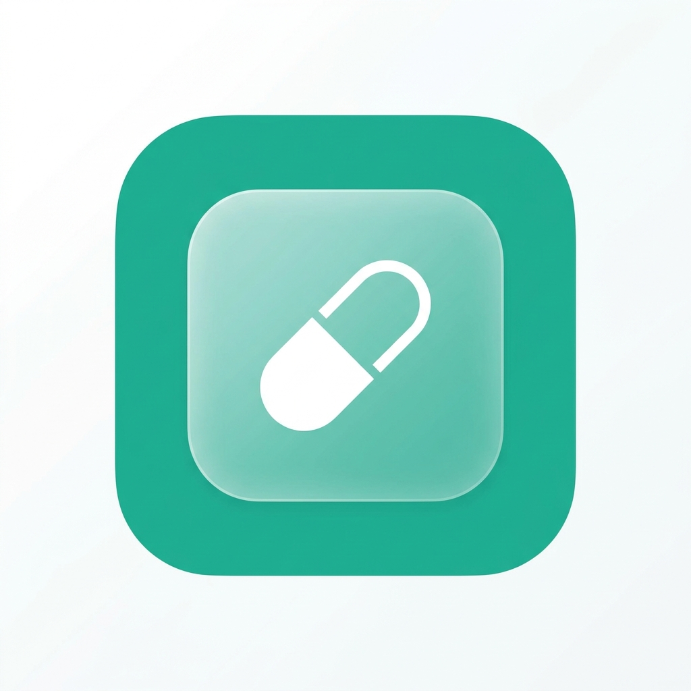

<div align="center">
  
  <h1>MediFill</h1>
  <p><strong>Your intelligent medicine management companion — one codebase for Android, iOS and the web</strong></p>

  <p>
    
    
    
    
  </p>
</div>

---

## 📱 Overview

**MediFill** is a cross-platform medicine tracker built with Expo and React Native. The **same code** runs as:

| App | How it runs |
|---|---|
| 📱 **Mobile app** (Android / iOS) | In **Expo Go** during development, or as an installable build |
| 🌐 **Website** (Windows, Mac, any browser) | In the browser via Expo for Web, deployable as a static site |

It helps you manage medicines, get reminded at the right time, track stock, catch expiry dates and see your daily dose schedule.

---

## ✨ Features

### 💊 Medicine management
- Add medicines manually or **scan the label with the camera (OCR)** — live camera, phone camera app or gallery upload
- Input checks as you type: medicine name, whole-number quantities, current ≤ total, duplicate detection, future expiry date
- Edit or delete any medicine; visual stock bar

### 📅 Schedule
- 7-day strip plus a **month calendar** with dots: all taken / some taken / missed / scheduled
- Tap **Take** to log a dose — uses one unit of stock (undo gives it back)
- Medicines past their expiry date are **crossed out** and can't be taken
- "Every other day" and "Once a week" medicines appear only on their dose days
- Daily adherence bar

### 🔔 Notifications
- **Dose reminders** at each dose time
- **Missed-dose follow-ups every 5 minutes** until you tap Take (1 hour on Android, 30 min on iPhone)
- **"Dose taken ✓"** confirmation when you tap Take
- **Refill reminder** when taking a dose leaves 20% or less — tap it to open the Pharmacy tab
- **Expiry reminders** 30, 7 and 1 day before, on the day, and the day after (9:00 AM)
- **Drug interaction warnings**
- Settings to switch each type on/off, plus **Do Not Disturb** (reminders arrive silently)

### 🏥 Pharmacy
- Find nearby pharmacies on Google Maps using your location
- Quick links to online pharmacies (Apollo, MedPlus, Netmeds, 1mg, PharmEasy, Healthkart)
- One-tap emergency helplines (108, 102, poison control)

### 👥 Profiles
- Firebase email/password sign-in
- Family profiles, each with its own medicines and reminders

---

## 🛠️ Tech Stack

| Layer | Technology |
|---|---|
| Framework | [Expo](https://expo.dev) SDK 52 + React Native 0.76 (+ React Native Web) |
| Language | TypeScript |
| Navigation | Expo Router (file-based) |
| Auth | Firebase Authentication |
| Storage | AsyncStorage on the device (per profile) |
| Notifications | `expo-notifications` (phone), Web Notifications + service worker (browser) |
| Camera / OCR | `expo-camera`, `expo-image-picker`, Google Cloud Vision |

---

## 🚀 Getting Started

### 1. Prerequisites
- [Node.js](https://nodejs.org) 20 or newer
- A Firebase project (Authentication → Email/Password enabled)
- For the mobile app: **Expo Go** on your phone — this project uses **SDK 52**. If the store version says the project is incompatible, install the SDK 52 build from [expo.dev/go](https://expo.dev/go).

### 2. Install
```bash
git clone https://github.com/SamStephen2006/MediFill.git
cd MediFill
npm install --legacy-peer-deps
```

### 3. Environment variables
Copy the template and fill in your own keys (the real `.env` is git-ignored and never committed):
```bash
cp .env.example .env
```

| Variable | Where to find it |
|---|---|
| `EXPO_PUBLIC_FIREBASE_*` | Firebase Console → Project Settings → Your apps |
| `EXPO_PUBLIC_SUPABASE_URL`, `EXPO_PUBLIC_SUPABASE_ANON_KEY` | Supabase → Settings → API |
| `EXPO_PUBLIC_GOOGLE_CLOUD_VISION_API_KEY` (optional) | Google Cloud → APIs → Credentials (for label scanning) |

### 4a. Run the 🌐 website (Windows / any browser)
```bash
npm run web
```
Opens **http://localhost:8081**. Use Chrome or Edge for notifications and the camera (browsers only allow these on `localhost` or `https://`).

### 4b. Run the 📱 mobile app (Expo Go)
```bash
npm run dev
```
Scan the QR code with **Expo Go** (Android) or the **Camera app** (iPhone). Phone and computer must be on the same Wi-Fi.

> **Windows tip:** if your PC has VirtualBox/VMware adapters, Expo may advertise the wrong IP and the phone can't connect. Pin it to your Wi-Fi address:
> ```powershell
> $env:REACT_NATIVE_PACKAGER_HOSTNAME = '192.168.x.x'; npx expo start
> ```

### 5. Build the website for hosting
```bash
npm run build:web
```
Outputs a static site in `dist/` (Netlify config included in `netlify.toml`).

---

## 📁 Project Structure

```
MediFill/
├── app/                      # Screens (Expo Router)
│   ├── (tabs)/               # Home, Add, Schedule, Pharmacy, Profile
│   ├── auth.tsx              # Login / sign-up
│   ├── camera.tsx            # Label scanning
│   └── _layout.tsx           # Root layout, notification tap handling
├── components/               # MedicineCard, MonthCalendar, TimePickerModal, DateTimePicker
├── context/                  # AuthContext, MedicineContext (medicines, alerts, taken doses)
├── services/                 # notificationService, notificationPrefs, ocrService, firestoreSync
├── utils/medicineValidation.ts  # Shared form rules (name, quantity, expiry)
├── public/sw.js              # Service worker for browser notifications
├── constants/                # Theme, drug interactions
└── .env.example              # Template for your keys (safe to commit)
```

---

## 🔒 Security
- API keys live only in `.env`, which is git-ignored
- Firebase service files (`google-services.json`, `GoogleService-Info.plist`) are git-ignored

## ⚠️ Known issue
Cloud backup to Supabase currently fails (the app writes camelCase fields such as `currentQuantity`, the table uses `current_quantity`). Medicines are saved on the device; only the cloud copy is affected.

---

<div align="center">
  <p>Built with Expo + React Native</p>
</div>
